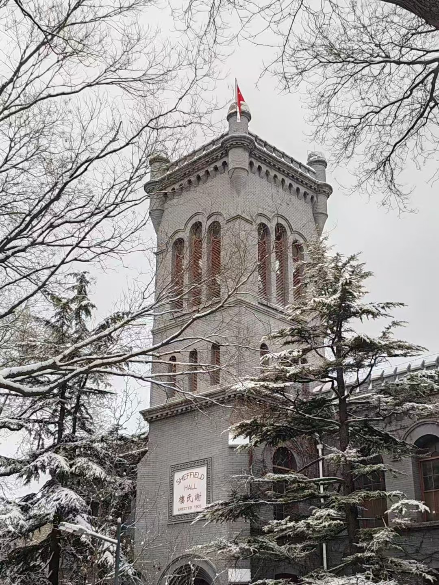
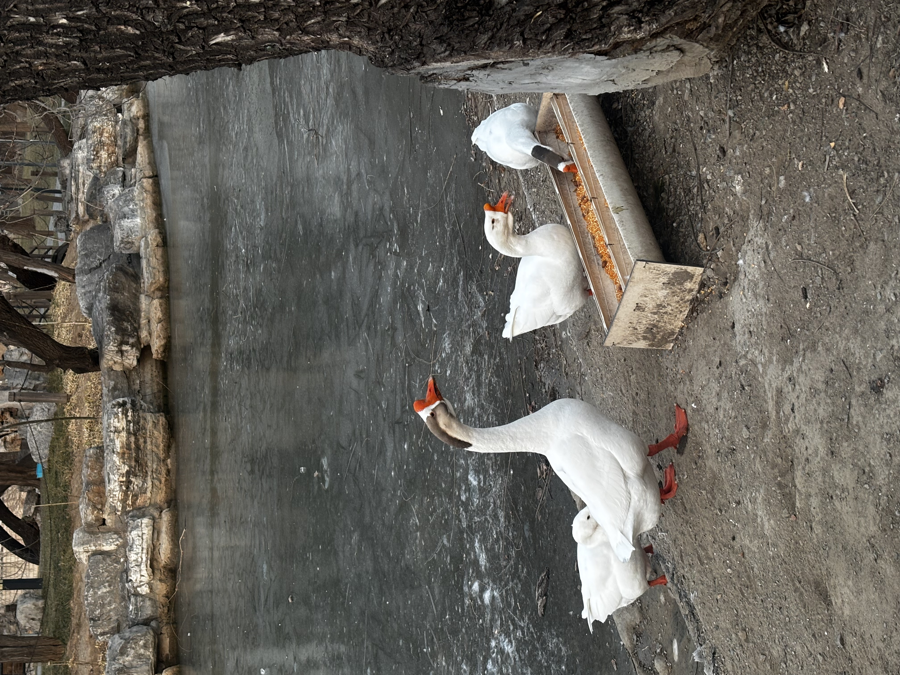

<!DOCTYPE html>
<html lang="en">

<head>
    <meta charset="UTF-8">
    <meta name="viewport" content="width=device-width, initial-scale=1.0">
    <title>欢迎来到潞河</title>
</head>

<body>
    <h1 id="top">欢迎来到潞河</h1>
    <h3>展厅内容：</h3>
    <ul>
        <a href="#history">
            <li>潞河中学的历史</li>
        </a>
        <a href="#campus">
            <li>校园风光</li>
        </a>
        <a href="#honors">
            <li>学校荣誉</li>
        </a>
        <a href="#stories">
            <li>我与潞河的故事</li>
        </a>
        <a href="#more">
            <li>更多内容</li>
        </a>
    </ul>
    <h2 id="history">潞河中学的历史</h2>
    
潞河中学创办于1867年，校园占地17万平方米，总建筑面积逾10万平米，一个多世纪前的建筑与格局保持完好，是北京市为数不多的、依然保持原址原貌的学校，是通州区第一个中共党支部诞生地，是北京市首批重点中学、首批示范性普通高中，首批百年学校。
    

    <a href="#top">返回顶部</a>
    <h2 id="campus">校园风光</h2>
    
年轮是树木的沉淀，皱纹是岁月的礼物。走进潞河中学，湖光山色、翠柏参天，奇花绿草覆地、通衢曲径散落其间。郁郁葱葱的爬山虎沿着建筑檐壁层层漫开，微风拂过，仿似绿色的波纹垂直荡漾在眼前；成群结队的鸟儿，戏花弄水，碑、亭、湖、山皆留有她们的身影，待欢畅时，百鸟齐鸣，热闹非凡。在这座建校时间比北京大学还要早的园林式校园里，厚重的历史文化底蕴与浓郁的现代学府氛围萦绕在你我之间，置身其中，不由心旷神怡，乐而忘返。 下面来欣赏一些美图吧！
    

    
    
    
    
    
    
    
    <a href="#top">返回顶部</a>
    <h2 id="honors">学校荣誉</h2>
    <table border="1">
        <thead>
            <tr>
                <th colspan="2">荣誉</th>
            </tr>
            <tr>
                <th>荣誉名称</th>
                <th>授予时间</th>
            </tr>
        </thead>
        <tbody>
            <tr>
                <td>首批北京市人工智能应用场景标杆学校培育名单（中小学）</td>
                <td>2026年1月29日</td>
            </tr>
            <tr>
                <td>第二批中小学人工智能教育基地</td>
                <td>2025年12月15日</td>
            </tr>
            <tr>
                <td>第二批北京市智慧校园示范校</td>
                <td>2024年10月</td>
            </tr>
        </tbody>
    </table>
    <a href="#top">返回顶部</a>
    <h2 id="stories">我与潞河的故事</h2>
    
本来刚开始创建文件的时候非常激动，想要大写特写来着，但写到这有点累了，所以简单写两笔吧。 
        我小学就作为潞河附属的小学的首届学生，初中和高中都在潞河中学度过。十二年的时光，潞河几乎贯穿了我目前的人生。十二年对我来说真的很长，但对于她159年的历史来说，也许不那么起眼。在这里，知识只是最不起眼的收获，那些独有的情谊和经历塑造了我的人格。我一直怀念珍惜着那些人和事。 
        因此，我将我精神的故乡，潞河，作为我第一次完成的作品的主题。

    <a href="#top">返回顶部</a>
    <h2>更多内容</h2>
    
如果你想了解更多关于潞河的内容，可以访问<a href="https://www.luhe.cn/" target="_blank">潞河官网</a>，或者关注潞河的微信公众号“潞河中学”。

    <a href="#top">返回顶部</a>
    <form>
        你是否喜欢上了潞河？
        <input type="radio" id="like" name="like">
        <label for="like">喜欢</label>
        <input type="radio" id="verylike" name="like">
        <label for="verylike">非常喜欢</label>
    </form>
</body>

</html>