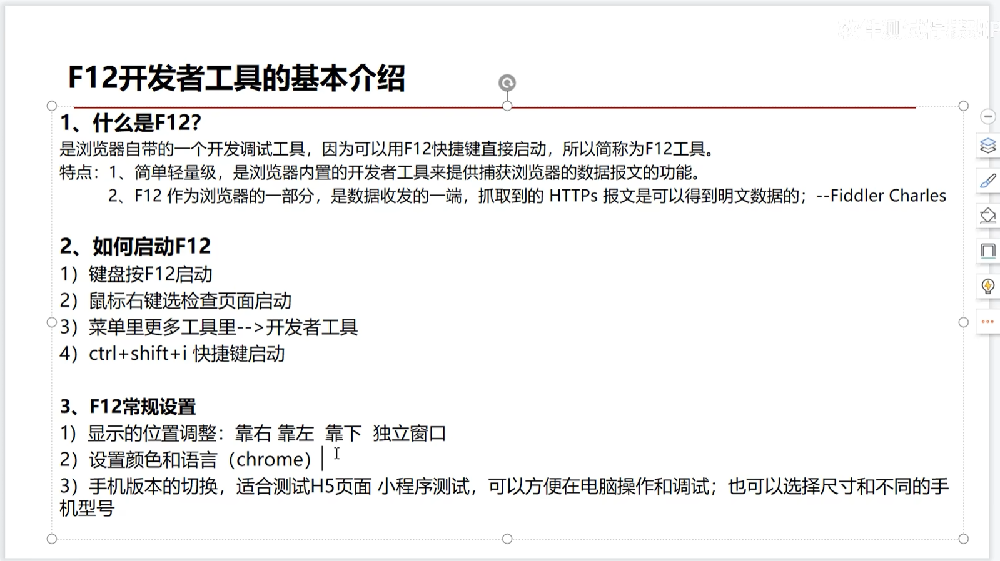
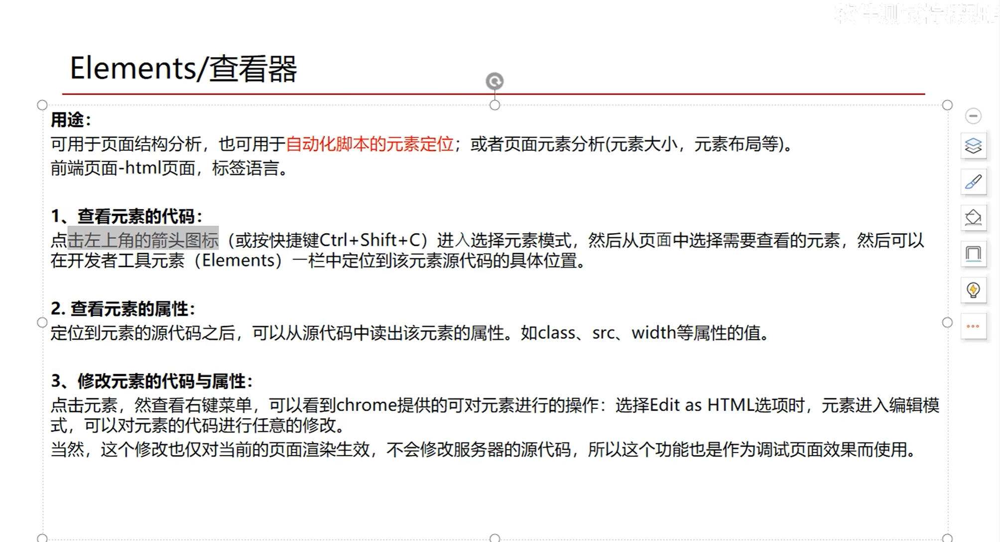
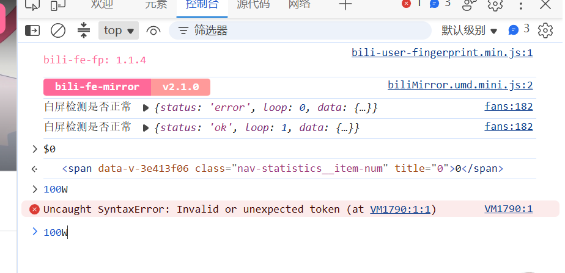
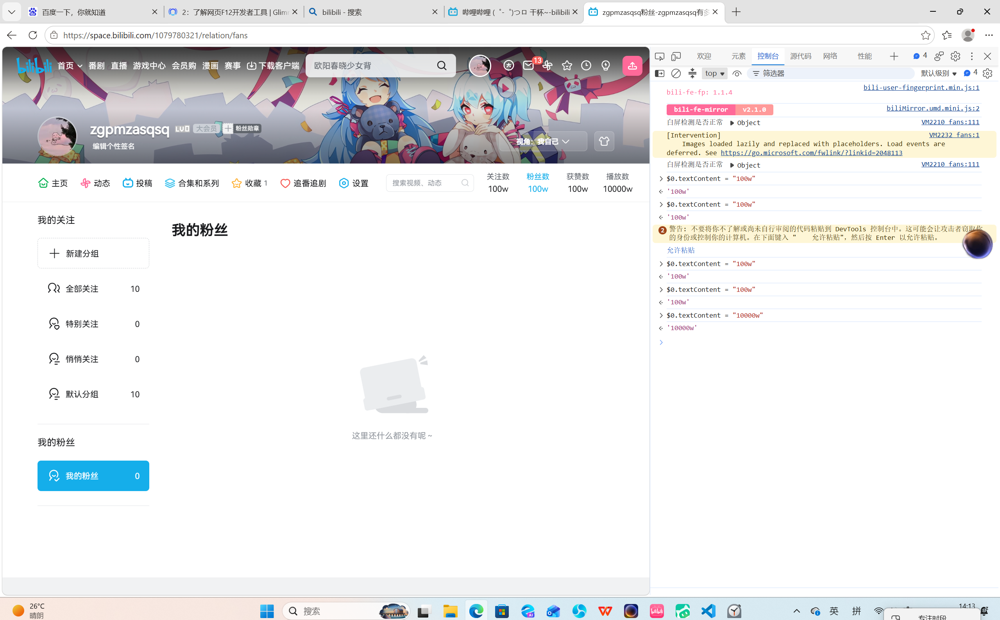
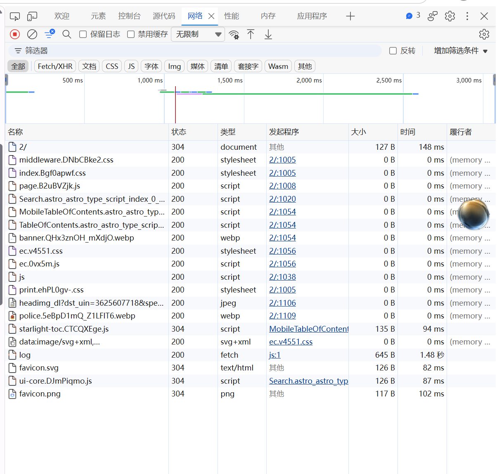
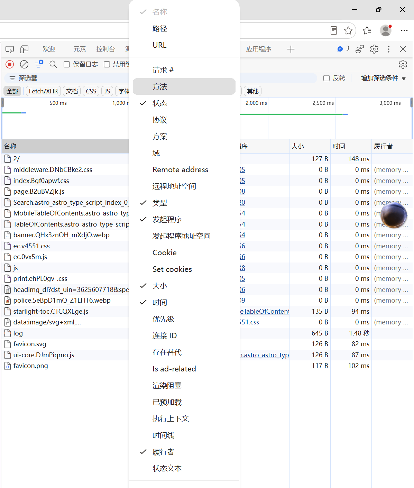
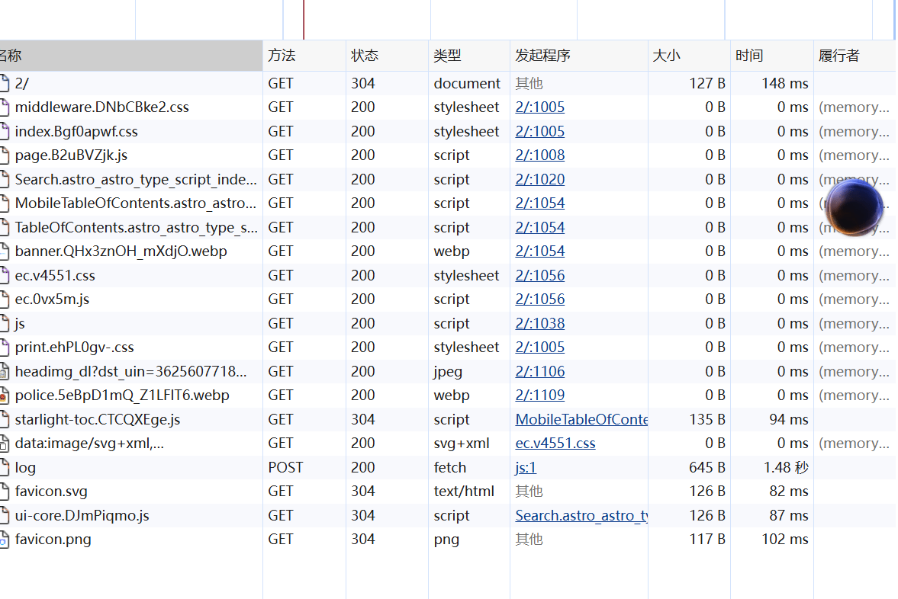
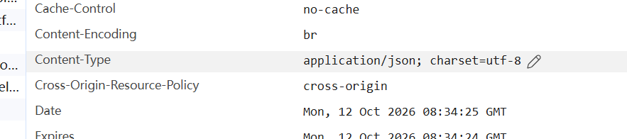
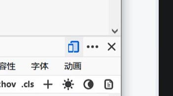

# 前端 2：了解网页 F12 开发者工具

王若菡 · 2026091601029

> **做题心得**：一般教程说单按 F12 即可，我的电脑需同时按 `Fn + F12` 才生效。

---

## 任务 1

### 题目原文

> 打开开发者工具，说说开发者工具的基础面板有哪些（至少列出 5 个）？然后自行了解一下它们各自的作用。在你列出的面板中，你觉得哪个对前端开发最有用？为什么？

### 作答内容

**基础面板及其作用：**

| 面板（中文 / 英文）        | 作用                           |
| ------------------ | ---------------------------- |
| 元素 / Elements      | 查看页面的 DOM 树与元素生效的样式，可双击直接编辑  |
| 控制台 / Console      | 显示页面日志与报错，可执行 JavaScript     |
| 源代码 / Sources      | 查看网页全部源文件，断点调试 JavaScript    |
| 网络 / Network       | 抓取所有网络请求与响应，查看状态码与请求头        |
| 性能 / Performance   | 录制分析页面运行性能                   |
| 内存 / Memory        | 分析内存占用，排查内存泄漏                |
| 应用程序 / Application | 查看 Cookie、LocalStorage 等本地存储 |
| Lighthouse         | 对页面做性能、无障碍、SEO 综合审计          |

**我认为最有用的是「元素 / Elements」面板。**

理由：前端的核心工作是把 HTML、CSS、JS 变成用户看到的界面，Elements 能实时看到 DOM 结构与最终生效的样式，双击修改即可立刻看到效果，定位布局与样式问题最快。



*图 1：F12 开发者工具的基本介绍（学习资料页）。*

---

## 任务 2

### 题目原文

> 打开你在第一题中制作的展览馆页面，在 Elements 面板中找到你写的标题和段落。试着双击修改页面上的一些文字，观察变化——然后刷新页面，发生了什么？想一想为什么？另外，在 B 站中打开控制台 (Console) 之后登入你的 B 站账号，你发现了什么？然后在你的个人空间中进行元素修改，向我们展示一下暂时的百万关注和点赞！（需要截图）

### 作答内容

**1. 双击修改文字后：** 页面上被修改的文字**立刻**变成新内容，效果即时可见。

**2. 刷新页面后：** 修改**全部消失**，页面恢复原样。

**原因：** 我改的是浏览器内存里的 DOM 副本，不是硬盘上的 HTML 源文件；刷新会重新请求 HTML 并重新生成 DOM 树，临时修改随之丢弃。

**3. 在 B 站控制台登录后的发现：** 控制台中出现了站点自身打印的日志（`bili-fe-fp: 1.1.4`、`bili-fe-mirror v2.1.0`）、白屏检测输出（`{status: 'error'}` 与 `{status: 'ok'}`），以及一条官方安全警告文案，提示不要将不了解的代码粘贴到控制台中。

**4. 个人空间元素修改：** 点击 Elements 面板左上角的元素选择图标选中关注数元素，再在 Console 中用 `$0.textContent = "100w"` 改写文字，即可展示出夸张的关注、粉丝与获赞数值。过程中因命令格式输入不正确触发了一次 `SyntaxError`，改为正确格式后成功。

**声明：** 以上仅为浏览器本地 DOM 的临时修改，服务器真实数据未变，刷新即复原。



*图 2：Elements / 查看器（学习资料页）。*



*图 3：Console 中 `$0` 已选中目标元素，以及命令格式输入不正确导致的 `SyntaxError` 报错。*



*图 4：B 站个人空间中关注、粉丝、获赞数值已被本地修改。*

---

## 任务 3

### 题目原文

> 什么是 Cookie？它解决了什么问题？如何查看 Cookie？以 B 站为例，找一两个你觉得有意思的 Cookie 字段，猜猜它是做什么用的。如果有人拿到了你的 Cookie，可能会发生什么？

### 作答内容

**什么是 Cookie：** 网站存放在浏览器本地的一小段"键 = 值"文本，由服务器通过 `Set-Cookie` 下发，此后浏览器每次请求该域名都会自动带上。

**解决了什么问题：** 解决 HTTP 协议**无状态**的问题——服务器本记不住"你刚才是否登录过"，Cookie 让它能识别身份、保持登录态、记住偏好设置。

**如何查看：** `Fn + F12` 打开开发者工具 → 「应用程序 / Application」→ 左侧「存储 / Storage → Cookie」→ 点开当前域名，右侧表格即为全部 Cookie。

**两个有意思的字段：**

| 字段名        | 我的猜测                          |
| ---------- | ----------------------------- |
| `SESSDATA` | 登录态凭证，最关键的一条，通常带 HttpOnly 保护  |
| `bili_jct` | CSRF 令牌，发评论、投稿等写操作时用于校验是否本人发起 |

**如果别人拿到了我的 Cookie：** 会造成**会话劫持**——攻击者无需密码，把 Cookie 放进自己浏览器即可被服务器认定为登录状态的本人，从而以我的身份发动态、看私信、修改资料，密码与验证码这层防护被完全绕过。因此 Cookie 等同于账号凭证，不得外泄。

---

## 任务 4

### 题目原文

> 切换到 Network 面板，刷新任意网页，观察产生的请求。这些请求大部分是 GET 还是 POST？找到一个状态码为 200 的请求和一个不是 200 的请求（如 404），说说分别代表什么含义？点开一条请求，在 Response Headers 中找到 Content-Type 字段，它告诉了我们什么？

### 作答内容

**1. 请求方法分布：** 刷新页面后共 20 条请求，其中 **GET 19 条、POST 1 条**（仅 `log` 一条）。

**结论：绝大多数是 GET。** 因为刷新网页主要是下载 HTML、CSS、JS、图片等资源；POST 只在提交数据时使用。

**2. 状态码为 200 的请求：** 如 `middleware.DNbCBke2.css`。**含义：请求成功**，服务器已正常返回所请求的内容。

**3. 不是 200 的请求：** 本次抓取到的非 200 样本状态码为 **304**，如 `2/`、`favicon.png`。

**含义：资源未被修改、命中缓存**——服务器告知浏览器本地缓存版本仍然可用，不重复传输内容，故"大小"列为 `0 B`。（题目举例的 404 则表示服务器上找不到该资源，本次未出现。）

**4. Content-Type 字段：**

```
Content-Type: application/json; charset=utf-8
```

**含义：** 它声明响应体的数据类型与字符编码，决定浏览器如何解析这段内容。本条表示返回的是 **JSON 格式数据**、采用 **UTF-8 编码**。



*图 5：Network 面板缺少「方法」列，无法区分 GET 与 POST。*



*图 6：在列头右键菜单中勾选「方法」，恢复该列显示。*



*图 7：恢复「方法」列后可见 19 条 GET、1 条 POST，状态码列含 200 与 304。*



*图 8：响应标头中的 `Content-Type` 字段。*

---

## 附录



*图 9：面板右上角图标区，其中左侧图标为设备模拟开关，可模拟不同型号手机页面。*

---

> 说明：为提高整理效率，本文档由我提供基本内容与截图，交由 WorkBuddy 结合我们的聊天记录进行排版与润色。
