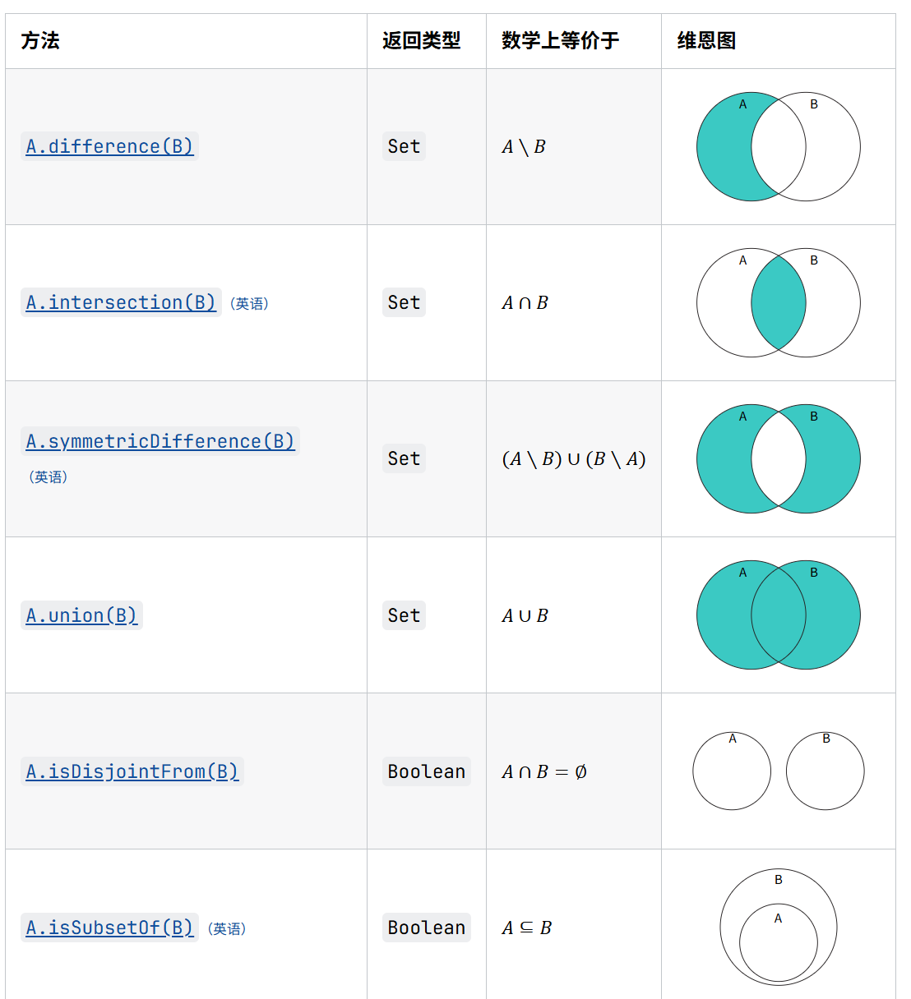
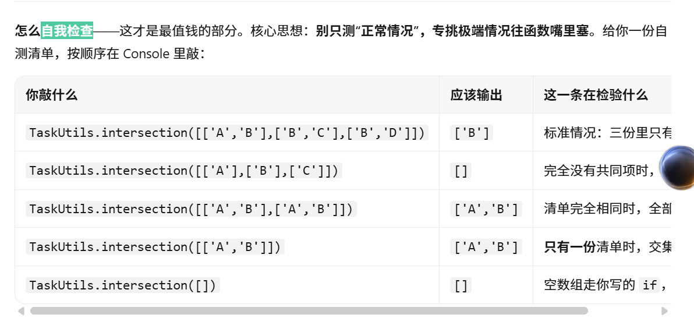

# 学习过程

## difference、intersection 和 union 分别表示什么？

difference(a, b) 求差集：返回在 a 里有、但 b 里没有的任务。intersection(taskLists) 求交集：返回所有清单里都有的任务。union(taskLists) 求并集：把多份清单合并成一份并去掉重复。三者对应数学里的 A−B、A∩B、A∪B，都是传入数组、返回数组。（学习过程网页截图如下）

## 本题中的"共同任务"为什么不能只比较前两位成员？

"共同任务"的定义是每一份清单都包含它。只比较前两位，后面的人一旦没有这项，它就不是共同任务。比如前两份都有"需求验收"，第三份没有，只比前两位就会把它误判进来。

## Set 和数组有什么不同？它在本题中解决了什么问题？

数组有序、允许重复，靠下标访问；Set 不存重复元素，还自带 difference、intersection、union 等集合运算方法。本题中它解决了两件事：一是求差、交、并不用手写循环判断，直接调方法；二是合并清单时自动去重，保证"所有不同任务"不会重复计数。

## 有没有遇到什么问题？通过什么关键词或方法解决的？

1.一开始const 的时候没加new，出现了TypeError

2.返回形式不是数组，用Array.from()

3.目标二一开始想返回字符串形式，发现不成功。最后返回【】

## 如果任务清单中本身出现了重复内容，你的代码会怎样处理？这是你预期的结果吗？

会自动处理。三个函数都先把数组转成 Set，重复内容在转换这一步就被去掉，输出的清单里不会出现重复任务。这是预期结果：同一件事在清单里写两遍，也不应该被统计两次，比如"所有不同任务"的总数不会因此虚增。

## 自由探索

- 在页面中增加一位新的项目成员，并观察结果是否会自动变化；

  第一块多出一张「小明 / 运维工程师」卡片 ，第四块总数从 16 项变成 17 项（新增「环境搭建」一项），第三块不变，因为 cooperationGroups 里没有「运维工程师」
- 增加一种新的"多人配合组合"；

  ['后端工程师', '产品经理', '运维工程师']，添加后第三块增加了一个模块（没有新内容，因为并集为空集）
- 在页面中显示所有不同任务的数量；

  修改前面后自动有显示
- 为三个函数分别补充更多测试数据。

  下面是向AI提问的检查函数是否能自我检查的回答截图，三个函数都在控制台进行了类似检测）

## 问题

- every()：所有元素都满足条件才返回 true（全票通过）

- filter()：筛选出满足条件的元素，返回新数组 
  
- forEach()：对每个元素执行一遍操作，没有返回值
