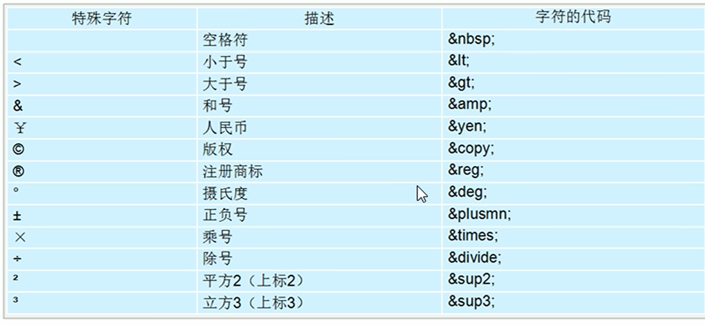

<!DOCTYPE html>
<html lang="en">

<head>
    <meta charset="UTF-8">
    <meta name="viewport" content="width=device-width, initial-scale=1.0">
    <title>Document</title>
</head>

<body>
    <a href="#time" id="top">
        <h2>潞河缘</h2>
    </a><!-- h2标签用于定义标题，数字越小，标题的级别越高，字体也会相应变大。 -->
    
这是一个简单 的段落。
 <!--
会自动换行， 相比不会增加额外间距。-->
    
潞河中学创办于1867年，校园占地17万平方米，总建筑面积逾10万平米，一个多世纪前的建筑与格局保持完好，是北京市为数不多的、依然保持原址原貌的学校，是通州区第一个中共党支部诞生地，是北京市首批重点中学、首批示范性普通高中，首批百年学校。 
        　　 年轮是树木的沉淀，皱纹是岁月的礼物。走进潞河中学，湖光山色、翠柏参天，奇花绿草覆地、通衢曲径散落其间。郁郁葱葱的爬山虎沿着建筑檐壁层层漫开，微风拂过，仿似绿色的波纹垂直荡漾在眼前；成群结队的鸟儿，戏花弄水，碑、亭、湖、山皆留有她们的身影，待欢畅时，百鸟齐鸣，热闹非凡。在这座建校时间比北京大学还要早的园林式校园里，厚重的历史文化底蕴与浓郁的现代学府氛围萦绕在你我之间，置身其中，不由心旷神怡，乐而忘返。 
        　　 潞河中学的历任校长和一批批教师在跨越三个世纪的办学实践中不断探索积淀，形成了一脉相承的学校传统和独具特色的教育风格。培养了以侯仁之、黄昆、王洛宾、刘绍棠、张珍、辛德惠等为代表的众多中科院院士、艺术大师和共和国的部长将军，受到社会各界的广泛赞誉。  
        　　 学校始终坚持“一切为了祖国”的校训，逐步形成了以“坚持人本位与社会本位相统一的教育观；坚持一切为了学生发展的办学宗旨；坚持健全人格的培养目标；坚持多元开放的学校发展方向。”为核心内容的办学思想并成为引领学校发展的旗帜。 
        　　 学校先后被评为教育部依法治校示范校，全国文明校园，首都文明单位标兵，全国民族团结进步创建示范学校，全国学校艺术教育先进单位，国家级体育传统项目学校，北京市民族团结教育示范学校，北京市校园文化建设示范校，全国示范文学校园，北京市中小学科技示范学校等称号，北京市思想政治工作优秀单位。拥有北京市学生金帆书画院、北京市金鹏科技团、北京市金奥运动队。此外学校还承担了“可持续发展教育国家实验学校”，“国家级教育体制改革试点项目基础教育课程教材改革试验项目学校”，“国家级和北京市两级高中特色发展试验项目校”等任务。
    

    
文本可以设置<strong>粗体</strong>、<em>斜体</em>、<del>删除线</del>、<ins>下划线</ins>的效果

    
这是一个div元素。

    这是一个span元素。 
    <!-- div 标签用来布局，但是现在一行只能放一个 div，大盒子。
span 标签用来布局，一行可以多个 span，小盒子。 -->
    
    <!-- img 标签用于插入图片，src 属性指定图片的路径，alt 属性提供图片的替代文本，width 和 height 属性设置图片的宽度和高度,宽高取其一便可等比例缩放 -->
    <a href="https://www.luhe.cn/" target="_blank">潞河官网</a>
    <!-- a 标签用于创建超链接，href 属性指定链接的目标 URL，target="_blank" 表示在新窗口中打开链接,_self是默认值，覆盖网页。图片可以作为链接的载体，直接替换文字部分即可 -->
    
我与潞河缘起与2014年
<a href="#top">返回顶部</a>
    

    <table border="1">
        <thead>
            <tr>
                <th colspan="3">历任校长</th>
            </tr>
            <tr>
                <th>序号</th>
                <th>姓名</th>
                <th>任职时间</th>
            </tr>
        </thead>
        <tbody>
            <tr>
                <td>1</td>
                <td>侯仁之</td>
                <td>1867-1870</td>
            </tr>
            <tr>
                <td>2</td>
                <td>黄昆</td>
                <td>1870-1875</td>
            </tr>
            <tr>
                <td>3</td>
                <td>王洛宾</td>
                <td>1875-1880</td>
            </tr>
        </tbody>
    </table>
    <ul>
        <!-- 只能包含li标签，表示无序列表，前面有小圆点 -->
        <li>项目一</li>
        <li>项目二</li>
        <li>项目三</li>
    </ul>
    <ol>
        <!-- 只能包含li标签，表示有序列表，前面有数字 -->
        <li>项目一</li>
        <li>项目二</li>
        <li>项目三</li>
    </ol>
    <dl>
        <!-- 只能包含dt和dd标签，表示定义列表，dt表示术语，dd表示术语的定义 -->
        <dt>术语一</dt>
        <dd>术语一的定义</dd>
        <dd>术语一的定义的详细解释</dd>
        <dt>术语二</dt>
        <dd>术语二的定义</dd>
    </dl>
    <form>
        用户名：<input type="text" name="username" maxlength="3" /> 
        密码：<input type="password" name="password" /> 
        选择性别：<label for="male">男</label><input type="radio" id="male" name="gender" value="male" id="male"/> <label for="female">女</label><input type="radio" id="female" name="gender" value="female" /> 
        <!-- radio按钮必须有相同name才可以多选一，否则可以多选。 -->
        选择爱好：篮球<input type="checkbox" name="hobby" value="basketball" /> 足球<input type="checkbox" name="hobby" value="football" /> 羽毛球<input type="checkbox" name="hobby" value="badminton" /> 
        选择城市：<select>
            <option value="beijing">北京</option>
            <option value="shanghai">上海</option>
            <option value="guangzhou" selected="selected">广州</option>
            <option value="shenzhen">深圳</option>
            <option value="hangzhou">杭州</option>
        </select> 
        <input type="submit" value="点击提交" />
        <input type="reset" value="重置按钮" />
        上传文件：<input type="file" name="file" /> 
        选择日期：<input type="date" name="date" /> 
    </form>
    <form><textarea>请输入文本</textarea></form>
</body>

</html>